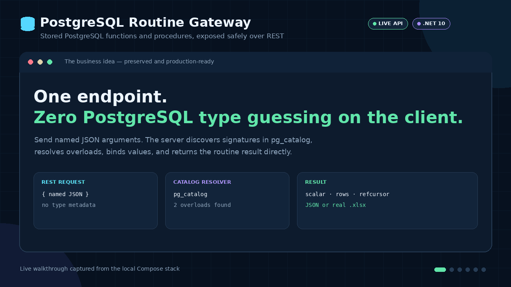
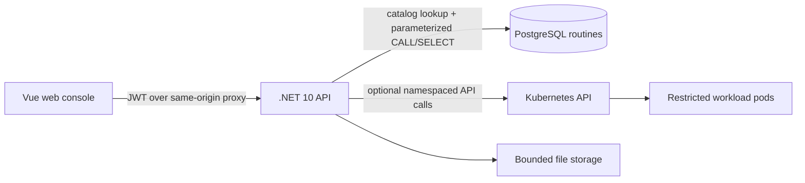

# Postgres Control Plane

[](../../actions/workflows/ci.yml)

A security-first .NET and Vue gateway that exposes existing PostgreSQL functions, procedures and cursor-backed reports through typed REST calls, with Excel export, a database explorer and optional deployment automation.

The project began as a university diploma whose central idea was calling PostgreSQL stored routines over REST. It has since been rebuilt as a portfolio-grade system: catalog-driven overload resolution, named parameter-only invocation, no arbitrary SQL endpoint, deny-by-default authorization, revocable JWT sessions, bounded results, automated tests and a polished web console.

## Live API demo

[](docs/media/routine-gateway-demo.gif)

This walkthrough was generated from responses returned by the running Docker Compose stack—not from mocked payloads. It shows one stable REST address selecting two PostgreSQL overloads from ordinary JSON, an explicit `409` for a genuinely ambiguous `null`, a `refcursor` fetched as JSON, and the same cursor exported as a real workbook.

[Download the generated Excel report](docs/media/orders-report.xlsx) · [Open the static 1280×720 poster](docs/media/routine-gateway-demo.png) · [Reproduce the media locally](docs/media/README.md)

## What it does

- Discovers PostgreSQL function/procedure signatures and invokes them through stable schema/name REST addresses using named JSON arguments and catalog-resolved types.
- Automatically resolves overloaded routines by argument names, defaults and JSON/type compatibility; an explicit overload is only an ambiguity escape hatch.
- Supports default arguments in any named position, `IN`/`OUT`/`INOUT` parameters, scalar results and set-returning functions.
- Fetches `refcursor` functions inside their PostgreSQL transaction and returns the rows as JSON or a configurable `.xlsx` workbook.
- Browses PostgreSQL schemas, relations, triggers and paginated rows through server-generated read-only queries.
- Manages application users and roles without exposing password hashes or persisted sessions.
- Creates simulated deployments locally and optional namespaced workloads in Kubernetes.
- Stores deployment credentials only in Kubernetes Secrets, never in API responses or the control-plane database.
- Records metadata-only audit events without request bodies, tokens, passwords, filenames or SQL text, with configurable retention.
- Provides liveness and database-aware readiness endpoints.

> Clients can invoke pre-existing, allowlisted routines but cannot submit SQL, create functions or execute DDL.

## Quick start

Requirements: Docker with Compose v2.

```bash
cp .env.example .env
# Replace all local passwords and the JWT signing key in .env.
docker compose --env-file .env up --build
```

Then open:

- Web console: <http://localhost:5173>
- API Swagger UI: <http://localhost:5050/server/swagger>
- Readiness: <http://localhost:5050/server/health/ready>

The administrator username and password come from `BOOTSTRAP_ADMIN_USERNAME` and `BOOTSTRAP_ADMIN_PASSWORD` in your untracked `.env`. Kubernetes integration is disabled in Compose; deployment operations use a safe simulated adapter.

## Architecture



The API is the trust boundary. It validates authentication and authorization before DTO mapping, database access, file operations or Kubernetes calls. See [architecture](docs/architecture.md) and [threat model](docs/threat-model.md) for the design rationale.

## API surface

| Area | Routes | Access |
|---|---|---|
| Authentication | `/api/auth/login`, `/api/auth/me`, `/api/auth/logout` | login is anonymous; profile and logout require a session |
| Users and roles | `/api/users`, `/api/roles` | `superadmin` |
| Database catalog | `/api/database/schemas`, `/tables`, `/routines`, `/triggers` | `superadmin` |
| Routine invocation | `POST /api/database/routines/{schema}/{name}/invoke` | `superadmin`, allowlisted schemas |
| Cursor Excel export | `POST /api/database/routines/{schema}/{name}/export/xlsx` | `superadmin`, allowlisted `refcursor` functions |
| Deployments | `/api/deployments/*` | `superadmin` |
| Files | `/api/files/*` | `superadmin`, allowlisted and size-limited |
| Health | `/health/live`, `/health/ready` | anonymous |

All API routes are served below `/server` by default. Swagger is exposed only in the Development environment.

## PostgreSQL routines over REST

`GET /server/api/database/routines?schema=public` returns exact signatures, PostgreSQL argument names/types, modes, defaults, volatility, cursor capability and whether each routine is allowed for REST invocation. PostgreSQL OIDs are deliberately absent from the public contract. Discovery is useful for generic consoles, but an application client can invoke a routine without loading the catalog first.

Invoke a function or procedure by passing named JSON values:

```http
POST /server/api/database/routines/public/calculate_order_total/invoke
Authorization: Bearer <access-token>
Content-Type: application/json
```

```json
{
  "arguments": {
    "order_id": 1,
    "tax_rate": 0.2
  }
}
```

Scalar functions return their scalar result directly:

```json
144.00
```

Set-returning and cursor functions return a JSON array, composite and JSON results return objects, and procedures without `OUT` values return `204 No Content`.

The server loads same-name candidates from `pg_catalog`, matches argument names and required/default parameters, validates each JSON value against the candidate's PostgreSQL types and selects the single best match. JSON integers prefer `integer`, then `bigint` when required; fractional numbers prefer `numeric`. Names, casts and named-notation tokens used in generated SQL come only from the resolved catalog row, while values remain bound parameters.

If a request such as `{ "arguments": { "value": null } }` matches multiple overloads equally, the API returns `409 Problem Details` with a structured `candidates` list. Only then does the client need the optional canonical overload returned by the catalog:

```json
{
  "overload": "bigint",
  "arguments": {
    "value": "9007199254740993"
  }
}
```

This explicit form also lets JavaScript clients preserve integers larger than their safe numeric range. PostgreSQL OIDs never appear in either contract.

One ambiguity cannot be solved by a type hint: PostgreSQL treats `f(integer)` and `f(integer, integer DEFAULT 1)` as the same callable shape when only `value` is supplied. The gateway detects that case before execution and asks the caller to supply the additional argument or the database author to remove the shadowing overload.

### Cursor-backed Excel reports

The Compose demo includes `open_demo_orders_report(numeric) RETURNS refcursor`. The same cursor can be read as JSON through `/invoke` or exported:

```http
POST /server/api/database/routines/public/open_demo_orders_report/export/xlsx
Authorization: Bearer <access-token>
Content-Type: application/json
```

```json
{
  "arguments": {
    "minimum_subtotal": 100
  },
  "excel": {
    "fileName": "orders-report.xlsx",
    "sheetName": "Orders",
    "reportStartPosition": { "row": 2, "column": 2 },
    "autoFitColumns": true,
    "freezePane": { "rows": 2, "columns": 1 },
    "columnWidths": { "0": 18 },
    "rowHeights": { "0": 24 },
    "ranges": [],
    "cells": []
  }
}
```

The cursor is opened and fetched in one transaction. Workbook settings are validated and bounded; arbitrary formulas are not accepted. The response is the `.xlsx` file itself. The local database also seeds `calculate_order_total`, `list_demo_orders`, overloaded `format_value` functions and the mutating `record_demo_event` procedure.

## Technology

- .NET 10, ASP.NET Core, EF Core 10, Npgsql, ClosedXML
- PostgreSQL 17 for local development
- Vue 3, Vue Router, Vite 8
- Kubernetes client for optional namespaced provisioning
- xUnit HTTP tests, a real PostgreSQL Testcontainer for routine invocation, and frontend session/navigation/form tests
- Docker Compose and restricted Kubernetes manifests
- GitHub Actions, Dependabot, CodeQL, Gitleaks, Trivy image/configuration scans and a CycloneDX SBOM

## Development without Docker

Requirements: .NET SDK 10.0.302+, Node.js 22.20+ and PostgreSQL.

```bash
cp .env.example .env
set -a && source .env && set +a
dotnet restore PostgresControlPlane.sln
dotnet run --project src/PostgresControlPlane.Api
```

In another terminal:

```bash
cd admin-panel
cp .env.example .env.local
npm ci
npm run dev
```

Quality checks:

```bash
./scripts/verify.sh
# Windows PowerShell: ./scripts/verify.ps1
```

## Security posture

- Access tokens expire after 15 minutes and carry a random `jti`; only that non-secret identifier is persisted for revocation.
- The demo intentionally has no long-lived refresh token: after expiry, the user authenticates again.
- Authorization has an authenticated fallback policy, so new endpoints are closed unless explicitly marked anonymous.
- Identifiers accepted by the database browser have a strict PostgreSQL identifier grammar; values are parameterized, results are paginated and commands have a timeout.
- Routine schema/name/optional-overload lookups are parameterized. Automatic resolution uses argument names and JSON kinds, while every executable name and cast comes back from `pg_catalog`. Only configured schemas are invocable; values are bound parameters and JSON/cursor/Excel results have row, cell, byte and timeout limits.
- `SECURITY DEFINER`, variadic, composite, array and pseudo-type inputs are blocked by default. The API database role still determines what each routine may do, so production must grant it only the intended `EXECUTE` privileges.
- Kubernetes RBAC is namespace-scoped. Pods run non-root with a read-only root filesystem, default seccomp, no privilege escalation, dropped capabilities and resource limits.
- Public workload ingress is opt-in and configuration fails at startup unless its base URL is HTTPS and a TLS Secret is named.
- The repository contains examples only. Rotate any credentials that ever appeared in historical commits before publishing.

Please report security issues through the process in [SECURITY.md](SECURITY.md), not a public issue.

## Repository layout

```text
src/PostgresControlPlane.Api/       ASP.NET Core API and EF migrations
tests/PostgresControlPlane.Tests/   HTTP-level security tests
admin-panel/                        Vue web console and Nginx image
k8s/                                restricted example manifests
docs/                               architecture, deployment and threat model
compose.yaml                        local three-service stack
docker/postgres-init/               local demo routines and seed data
```

## Documentation

- [Architecture](docs/architecture.md)
- [Local and Kubernetes deployment](docs/deployment.md)
- [Threat model](docs/threat-model.md)
- [Original diploma capability inventory](docs/business-capability-inventory.md)
- [ADR: no arbitrary SQL in the public API](docs/adr/0001-no-arbitrary-sql.md)
- [ADR: expose stored routines through a stable REST gateway](docs/adr/0002-stored-routines-over-rest.md)
- [Contributing](CONTRIBUTING.md)
- [Changelog](CHANGELOG.md)
