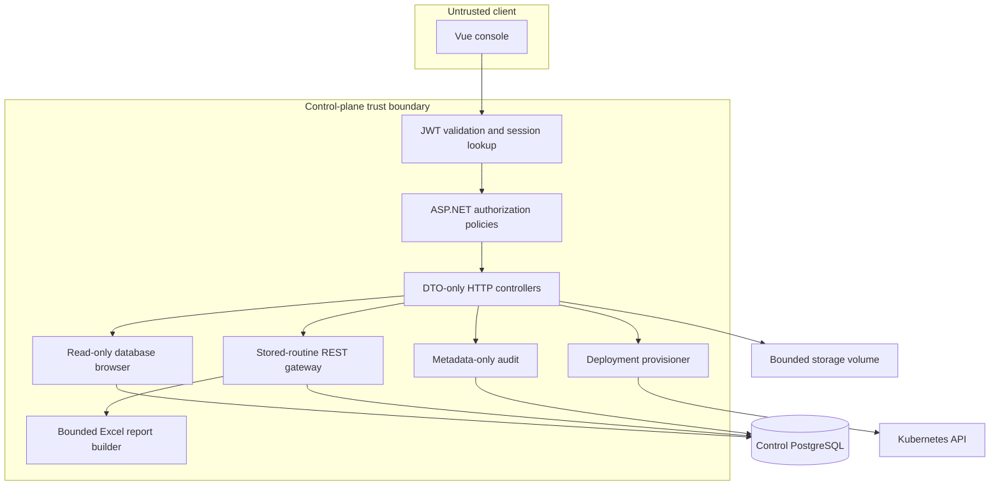

# Architecture

Postgres Control Plane has three runtime components: a Vue console, an ASP.NET Core API and PostgreSQL. Kubernetes is an optional external adapter and is disabled by default.



## Boundaries and responsibilities

- Controllers accept purpose-built contracts and never bind EF entities directly.
- Authentication validates signature, issuer, audience, lifetime and a server-side `jti` session record.
- The fallback authorization policy requires authentication. Administrative features require the built-in `superadmin` role.
- The database browser generates `SELECT` and catalog queries itself. It excludes the control-plane schema, validates schema/table identifiers, parameterizes values, caps cells and total responses, limits page size and applies command timeouts.
- The routine gateway discovers functions and procedures from `pg_catalog`. A client supplies schema/name plus named JSON arguments; it does not need PostgreSQL types. The resolver filters overloads by names, defaults and JSON compatibility, using deterministic numeric preferences and returning structured `409` candidates only for a genuine tie. Catalog lookups are parameterized; the server uses resolved catalog metadata—not request keys—to quote executable names and input types, binds every value, and applies execution and result limits. PostgreSQL OIDs remain internal.
- A function returning one `refcursor` is invoked and fetched inside the same transaction. Its rows use the normal JSON result shaper or the ClosedXML report builder; workbook coordinates, styles, row/column/cell counts and output bytes are bounded.
- Invocation is separately authorized through `Database.Execute`. Configured schema allowlists, PostgreSQL `EXECUTE` privileges and the `SECURITY DEFINER` block form independent controls.
- The provisioner is simulated unless explicitly enabled. In Kubernetes mode it creates only namespace-scoped ConfigMaps, Secrets, PVCs, Deployments, Services and optional Ingresses.
- File storage uses generated IDs, path containment, allowlisted content types, magic-byte checks, Office package structure validation, streaming, pagination and a configured size cap.
- Audit events exclude bodies, query strings, authorization headers, cookies and secrets. A background worker removes events after the configured retention period.

## Data model

The control database stores users, application roles, user-role relationships, revocable session IDs, deployment metadata and audit metadata. It does not store raw JWTs, deployment database passwords or bootstrap administrator passwords.

EF Core migrations are the single schema source of truth. Optional migration and bootstrap operations are explicit configuration switches rather than unconditional startup behavior.

## Routine invocation flow

```mermaid
sequenceDiagram
    participant UI as Vue console
    participant API as Routine API
    participant Catalog as pg_catalog
    participant Routine as PostgreSQL routine

    UI->>API: POST /routines/{schema}/{name}/invoke + named JSON arguments
    API->>Catalog: Load same-name overloads and exact argument metadata
    Catalog-->>API: Names, defaults, types and privileges
    API->>API: Match names and JSON kinds; select best candidate
    opt Genuine ambiguity
        API-->>UI: 409 + canonical overload candidates
        UI->>API: Retry with optional overload
    end
    API->>Routine: Parameterized CALL or SELECT
    Routine-->>API: Scalar, OUT, bounded row set or refcursor
    API->>Routine: FETCH cursor in the same transaction
    API-->>UI: Raw JSON result, 204, or bounded XLSX
```

The catalog is resolved for every invocation, so a separately written frontend can call a routine without a prior discovery request. The optional `overload` escape hatch contains canonical PostgreSQL input types and is needed only when names, defaults and JSON values do not identify one best candidate. Generic catalog-driven clients may send it immediately after a user selects an exact signature. Transient catalog OIDs never appear in frontend code.
